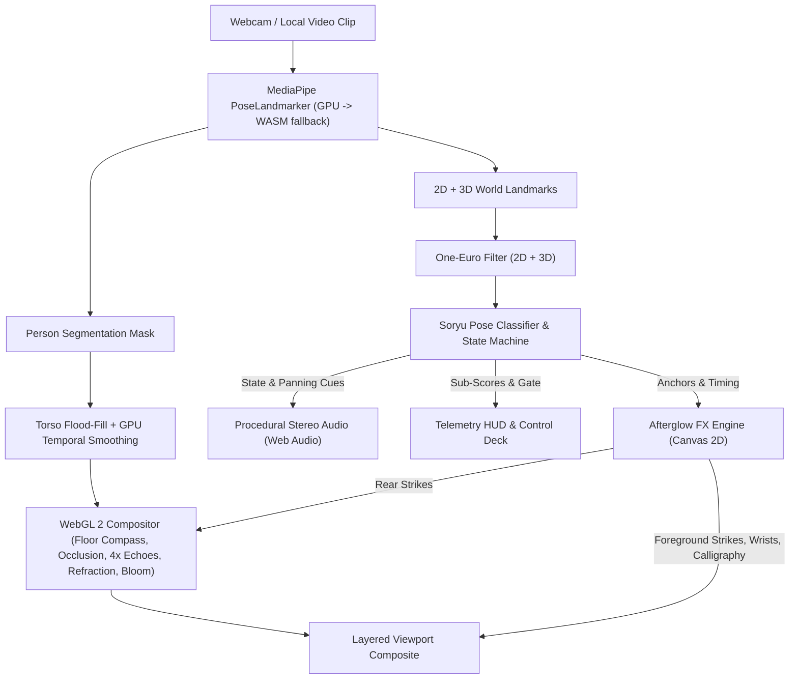
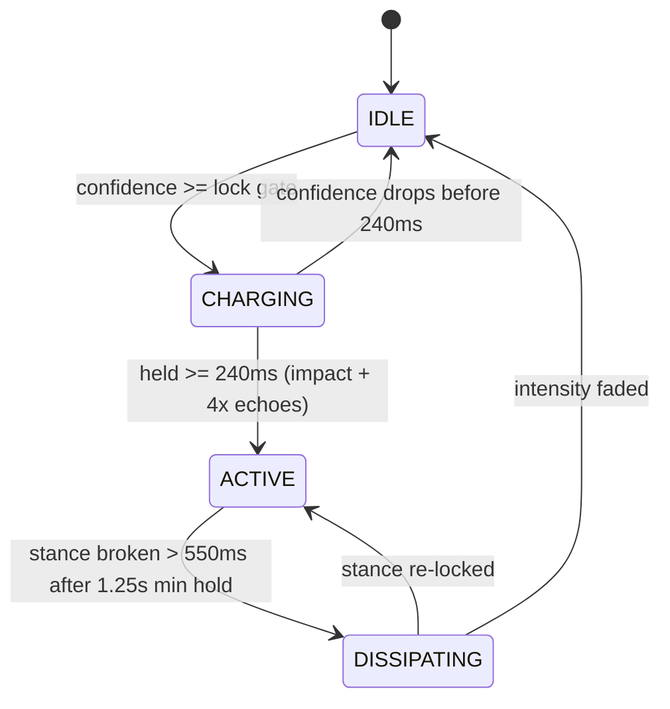

# 破壊殺・終式 青銀亂殘光 — Akaza Pose VFX

**Live Demo:** [https://akaza.mcedric.dev](https://akaza.mcedric.dev)

A real-time, 100% in-browser camera VFX web app inspired by Akaza's **Destructive Death — Final Form: Blue Silver Chaotic Afterglow** (*Hakai-satsu, Shūshiki: Aogin Ranzankō*) from *Demon Slayer: Kimetsu no Yaiba*.

Strike Akaza's **Soryu martial arts stance** in front of your webcam. The 12-point **Snowflake Compass Needle** (*破壊殺・羅針*) opens under your feet, a shockwave refracts the room, and four blue-silver silhouettes fan out around you — each replaying a different delayed moment of your movement.

---

## Features

- **100% Client-Side Real-Time CV & Fast Cold Start**: Runs MediaPipe Tasks Vision (`PoseLandmarker` BlazePose Lite FP16) locally in the browser using WebGL/GPU acceleration with automatic CPU/WASM fallback. Preloads the FP16 model and WASM fileset in parallel and lets the camera open immediately while CV warms up in the background.
- **One-Euro Adaptive Landmark Smoothing**: Implements the [One-Euro Filter](https://gery.casiez.net/1euro/) per axis for both 2D normalized landmarks (`minCutoff: 0.85 Hz`, `beta: 3.2`) and 3D `worldLandmarks` (`minCutoff: 1.0 Hz`, `beta: 2.5`) with >400 ms stale-gap reset and reusable pre-allocated buffers.
- **Scale-, Yaw-, and Mirror-Invariant Soryu Classifier**: Uses multiplicative geometric gating across 3D `worldLandmarks` and 2D normalized proportions so casual gestures, waving, walking strides, and sitting at a desk stay `IDLE`:
  - **3D lateral stance projection** onto the shoulder-to-shoulder axis (stays wide at 30°–45° yaw while rejecting front-to-back walking strides)
  - **Both-knees flexion check** (`avgKneeAngle` + `maxKneeAngle`) with seated-chair rejection
  - **Asymmetric Soryu guard**: extended/forward lead fist at shoulder height (with nose/mouth/ear proximity and chest-midline guards) paired with a flexed rear chamber near the hip
  - **Automatic Full-Body ↔ Desk Mode** adaptation with strict in-frame wrist/elbow gating
- **Hysteresis Temporal State Machine**: `IDLE → CHARGING → ACTIVE → DISSIPATING` with `240 ms` charge debounce, `1.25 s` minimum active hold, `550 ms` exit grace, live strictness presets (`Relaxed 58%` / `Balanced 68%` / `Strict 78%`), and optional **`Burst 5s`** mode so you can trigger once and punch freely through the full sequence.
- **WebGL 2 Depth Compositor**: Uses MediaPipe's person confidence mask (cleaned via torso-seeded flood fill and GPU temporal smoothing) to keep the performer in front of the perspective-projected floor compass, rear strikes, and aura. Adds Sobel rim lighting, two-pass separable bloom, and shockwave background refraction, with automatic Canvas 2D fallback if WebGL is unavailable.
- **Delayed Motion Silhouettes**: Captures masked camera snapshots into an 8-layer `TEXTURE_2D_ARRAY` and replays four glowing silhouettes delayed by ~140–470 ms around the tracked stance.
- **Foreground VFX**: Pre-baked offscreen sprites for the razor-needle barrage, Koyuki firework bursts, wrist-tracked vortices, face-protected compositing, and a timed calligraphy reveal.
- **Procedural Stereo Web Audio**: Synthesizes the rising charge tone, compass impact drop, four stereo-panned echo cues synced to silhouette entrances, sweeping foreground slashes, and wrist-panned punch bursts entirely in-browser.
- **Control Deck (`C` key) & Telemetry HUD (`D` key)**: Live strictness presets and lock-gate slider, `Hold` / `Burst 5s` release toggle, per-layer pipeline switches (`Depth Matte`, `4× Echoes`, `Compass`, `Strikes`), FX intensity and audio level sliders, camera device selector, live FPS/inference/matte/FX latency counters, One-Euro filter toggle, and debug skeleton overlay.
- **Video Clip Test Mode**: Load any browser-supported local `.mov` or `.mp4` clip to run the full pipeline on repeatable footage (`Space` to pause/resume).

---

## Architecture



### Temporal State Machine



This is a camera-relative 2.5D pipeline. The compass is inverse-projected onto a floor plane anchored to the tracked feet while a stabilized person matte separates background and foreground layers. Because MediaPipe and the compositor own separate WebGL contexts, GPU masks are downsampled into an 8-bit target inside MediaPipe's context, read back synchronously inside the inference callback, flood-filled from the tracked torso to suppress bystanders, and uploaded for GPU temporal stabilization and echo history capture.

---

## Running Locally

```bash
npm install
npm run dev
```

Open `http://localhost:5173` and click **Initialize Camera**. Step back until your knees/feet fit in frame, drop into a wide horse stance, raise your lead fist forward at shoulder height, and chamber your rear fist low by your hip.

### Keyboard Shortcuts

| Key | Action |
| --- | --- |
| `D` | Toggle CV Telemetry HUD & skeleton overlay |
| `C` | Toggle Control Deck (strictness, burst mode, layer toggles, volume, camera) |
| `S` | Toggle manual FX preview simulation |
| `M` | Mute / unmute procedural sound FX |
| `G` | Show / hide pose stance guide |
| `Space` | Pause / resume loaded video clip |

---

## Tech Stack

- **React 19 + TypeScript + Vite 6 + Tailwind CSS v4**
- **MediaPipe Tasks Vision** (`@mediapipe/tasks-vision`)
- **WebGL 2 / GLSL**, **Canvas 2D**, and **Web Audio API**
